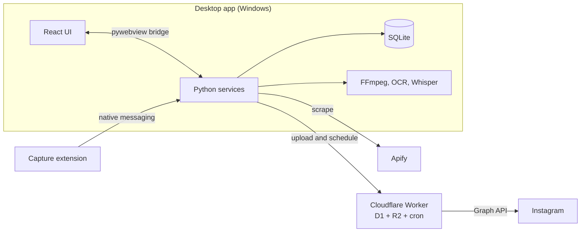

# NicheFlow Studio

A Windows desktop app for running a small network of Instagram Reels accounts in
one niche. It finds candidate clips, helps you review them, turns the ones you
keep into finished vertical Reels with titles and captions, spreads them across
your accounts, and publishes them on a schedule.

## What it does

- **Source.** Scrapes Instagram profiles through Apify (no Instagram login
  needed), captures the Reel you are watching with a Chrome/Edge extension,
  imports single URLs or local MP4s, and takes YouTube Shorts through `yt-dlp`.
- **Review.** Candidate queues scored against each creator's typical views,
  shared pools per niche, text and media deduplication, and rights-risk labels
  on pooled clips.
- **Process.** An FFmpeg pipeline with automatic crop and title-band detection,
  burned-in title overlays and post-header templates, cover picking with face
  detection, local OCR of the source's on-screen hook, and Whisper transcripts.
- **Draft.** Three title and caption options per clip, generated by Groq or
  through a copy-prompt / paste-back flow with any chat model. A guard checks
  drafts against what the clip actually shows.
- **Distribute.** Balanced assignment of pooled clips across accounts,
  per-account posting slots, daily caps, and minimum gaps between posts.
- **Publish.** A Cloudflare Worker (D1, R2, cron) posts through the Instagram
  Graph API, so the desktop app never handles Instagram tokens and the PC can be
  off at posting time. A local Playwright publisher remains as a fallback.

## Architecture



The React UI calls Python through an in-process pywebview bridge; every call
returns a small JSON envelope and long work (scrapes, downloads, renders,
uploads) runs as a background job the UI polls. SQLite is the single source of
truth, including draft revisions, so an external tool can write a draft and the
UI picks it up without a restart.

**Stack:** Python 3.12, SQLAlchemy, SQLite, FFmpeg, faster-whisper, RapidOCR,
OpenCV, Playwright, pywebview, PyInstaller. React 19, TypeScript, Vite,
Tailwind. Cloudflare Workers, D1, R2.

## Getting started

Full instructions, including the optional parts, are in
[docs/SETUP.md](docs/SETUP.md). The short version, in PowerShell:

```powershell
py -3.12 -m venv .venv
.\.venv\Scripts\pip install -r requirements.txt
.\.venv\Scripts\pip install -e .
.\scripts\dev_webview.ps1
```

Then open the **Settings** tab and add your Apify token. API keys are entered in
the app and stored on your machine only; nothing in this repo contains them.

| Setting | Needed for |
| --- | --- |
| Apify API token | Scraping (required) |
| Worker URL and API key | Cloud publishing (optional) |
| Groq API key | One-click AI drafts (optional; the chat path needs no key) |

## Tests

```powershell
.\.venv\Scripts\python -m pytest            # backend (about 1,900 tests)
cd frontend; npm run typecheck; npm run lint
cd cloudflare-publisher; npm run check; npm test
```

## Repository layout

```text
src/nicheflow_studio/   Python backend
  app/                  pywebview host and bridge (plus the legacy PyQt6 window)
  services/             workflows: pooling, processing, drafts, publishing, settings
  processing/           FFmpeg rendering, crop detection, OCR, draft prompts and guards
  scraper/, downloader/ Apify, yt-dlp, and Instagram media intake
  db/                   SQLAlchemy models and queries
frontend/               React UI
cloudflare-publisher/   Worker that publishes through the Instagram Graph API
browser-extension/      Chrome/Edge capture extension
scripts/                build, packaging, and maintenance scripts
docs/                   setup, design notes, and plans
```

## Responsible use

This tool automates posting to Instagram. Use it only with accounts you own,
publish only content you have the right to use, and stay within Instagram's
terms. The defaults are deliberately conservative (daily caps, minimum gaps
between posts, a sourcing allowlist that keeps publishing accounts away from
downloads, and rights-risk labels on pooled clips), but they do not grant any
rights to other people's work.

## Status

A personal project, built for Windows. The React app is the main UI. The older
PyQt6 window (`python -m nicheflow_studio`) still exists for workflows that have
not moved over yet and will be removed once they have.
